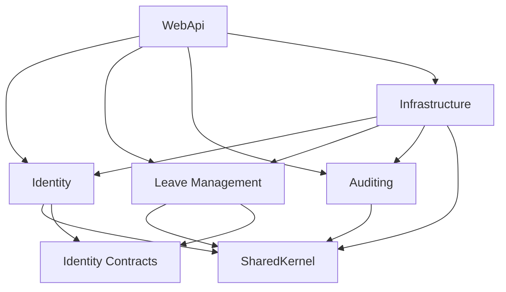

# Levio backend

Levio runs as one ASP.NET Core (.NET 10) application. Business code is organized
into independent module projects; all modules currently use one SQL Server
database through a shared EF Core context.

## Module ownership

| Project | Owns |
| --- | --- |
| `Modules/Levio.Modules.Identity` | Users, departments, roles, authentication endpoints, password hashing and JWT services |
| `Modules/Levio.Modules.LeaveManagement` | Leave types, calendar rules, requests, balances, validators, CQRS handlers and leave API endpoints |
| `Modules/Levio.Modules.Identity.Contracts` | Employee directory DTO and interface used across module boundaries |
| `Modules/Levio.Modules.Auditing` | Audit record domain model |
| `Levio.SharedKernel` | Base entity, base domain exception, generic repository and unit-of-work abstractions |
| `Levio.Infrastructure` | Shared SQL Server context, module-grouped EF mappings, seeds, repository adapters and migrations |
| `Levio.WebApi` | Composition root, middleware, Swagger, hosting and diagnostic endpoints |

Identity has working authentication services and controllers. Leave Management
now implements the employee self-service milestone from roadmap phase 8, with
the repository, validation and authorization work needed from phases 4, 5 and 7.
Auditing still contains the domain foundation for its later roadmap phase.

## Dependency rules



- Modules reference SharedKernel and explicitly permitted contract assemblies;
  they do not reference another module's implementation, Infrastructure, or EF
  Core. Domain and application folders live inside their owning module.
- Infrastructure implements repository ports declared by the owning module and
  registers persistence only. Each module registers its own application services.
- Cross-module relationships use scalar IDs. Infrastructure configures the
  existing foreign keys without entity navigation properties across modules.
- Entities and repository ports remain public for persistence adapters.
  Authentication service implementations are internal; the host uses module
  registration methods. Do not use public entity types as a shortcut for
  cross-module business calls.
- Leave Management uses `IEmployeeDirectory` from Identity.Contracts to check
  active employee status and the department's designated manager. Identity
  implements that interface. The contract project has no entity, repository,
  framework, or EF dependencies; architecture checks explicitly allow only these
  contract references.
- Shared persistence is an intentional compromise. There is one DbContext,
  transaction boundary, and migration history, so database changes remain
  coordinated. Module-specific contexts and independently deployed services are
  outside this conversion.

## Run locally

From the repository root:

```powershell
dotnet build Backend/Levio.slnx --configuration Release
dotnet run --project Backend/Levio.WebApi --launch-profile https
```

Install the .NET 10 SDK and configure `ConnectionStrings:DefaultConnection` for
SQL Server using the normal ASP.NET Core configuration providers. Configure
`JwtSettings:Issuer`, `Audience`, `SecretKey`, `AccessTokenMinutes`, and
`RefreshTokenDays`. Startup rejects missing issuer/audience, signing keys shorter
than 32 UTF-8 bytes, and nonpositive token lifetimes. Use environment variables
or local configuration overrides for deployment credentials.

The HTTPS launch profile listens on `https://localhost:7017` and
`http://localhost:5123`; Swagger is available at `/swagger` in Development.
Both Debug profiles open Swagger, and the Development root URL redirects there.
The HTTP-only profile disables HTTPS redirection through
`HttpsRedirection__Enabled=false`; HTTPS redirection remains enabled by default
for the HTTPS profile and deployments.
Use Release configuration if an existing Debug API process locks its output files.

## API compatibility and authentication fixes

Existing authentication routes remain:

- `POST /api/Auth/login`
- `POST /api/Auth/refresh-token`
- `POST /api/Auth/logout`
- `GET /api/Auth/testing`

The existing `/api/Test/testing`, `/api/Test/admin` and `/api/WeatherForecast`
diagnostics also remain. Controller discovery explicitly includes Identity.
Request and response JSON, JWT claims, and role names are preserved.

JWT issuance and response expiration now use `AccessTokenMinutes` consistently
(the existing configuration specifies 60 minutes rather than the old hardcoded
15). Refresh expiry uses `RefreshTokenDays`. Logged-out tokens are rejected by
refresh validation. The user lookup is asynchronous, and global exception
handling now maps invalid credentials and refresh tokens to JSON HTTP 401 responses.
Logout revokes refresh tokens; existing access tokens remain valid until expiry.

## Database and migrations

Tables, foreign keys, indexes, seeds, migration IDs, context name and migration
assembly are preserved. Existing databases require no migration for this refactor.
The API does not automatically apply migrations at startup.

From the repository root, use these commands when intentionally managing a
development database:

```powershell
dotnet ef migrations list --project Backend/Levio.Infrastructure --startup-project Backend/Levio.WebApi --configuration Release
dotnet ef migrations add YourChange --project Backend/Levio.Infrastructure --startup-project Backend/Levio.WebApi --configuration Release
dotnet ef database update --project Backend/Levio.Infrastructure --startup-project Backend/Levio.WebApi --configuration Release
```

New mappings and seeds go in the owning module's Infrastructure subfolder and
are discovered by `ApplicationDbContext`. Do not reset migration history or
create a replacement initial migration for existing databases.

## Leave self-service APIs

All new endpoints use `/api/v1`, require a bearer token, and return the documented
`success`, `message`, `data`, `errors` envelope. History includes pagination in
`meta`; successful cancellation returns HTTP 204. The legacy authentication
routes and their response shapes are unchanged.

| Method and route | Behavior |
| --- | --- |
| `GET /api/v1/leave-types` | List active types |
| `GET /api/v1/leave-types/{id}` | View active type details |
| `GET /api/v1/leave-balances?year=2026` | Own allocations, used, pending and available days |
| `GET /api/v1/leave-balances/{userId}?year=2026` | Designated department manager or HRAdmin access |
| `GET /api/v1/leave-requests?pageNumber=1&pageSize=10&status=Pending` | Own history, newest first; page size 1–100 |
| `GET /api/v1/leave-requests/{id}` | Owner, designated department manager, or HRAdmin |
| `POST /api/v1/leave-requests` | Submit Pending request, or save Draft |
| `PUT /api/v1/leave-requests/{id}` | Owner updates a Draft or submits it |
| `DELETE /api/v1/leave-requests/{id}` | Owner cancels Pending/Draft; restores a Pending reservation |

Employee, Manager and HRAdmin roles can use self-service. `RequireAuthenticated`,
`RequireEmployee`, `RequireManager` and `RequireHRAdmin` policies are registered.
The service independently checks active employee status and resource access
through the Identity contract. Request ownership always comes from the JWT,
never from a submitted employee ID.

Submit a request, choosing future/current dates:

```json
{
  "leaveTypeId": 1,
  "startDate": "2026-11-02",
  "endDate": "2026-11-03",
  "isHalfDay": false,
  "halfDayType": null,
  "reason": "Family function and travel arrangements.",
  "saveAsDraft": false
}
```

Set `saveAsDraft` to `true` to save without reserving balance. A PUT with
`saveAsDraft=false` submits an existing Draft and performs submission checks.
For half-day CL/SL, set the same start/end date, `isHalfDay=true`, and
`halfDayType="AM"` or `"PM"`. Corrected half-day and user-role enum names match
the specification; no database column or seeded value changes are required.

Validation rejects past dates, invalid/inactive leave types, reason text outside
10–500 characters or containing markup delimiters, invalid half-day combinations,
overlaps with Pending/Approved requests, insufficient balance and excessive
duration. Opposite AM/PM slots on the same working day may coexist. The default
limits are 30 eligible days per request, 5 consecutive CL days and 7 calendar
days' advance notice for EL. Defaults can be configured before deployment:

```json
{
  "LeaveCalendar": {
    "YearStartMonth": 4,
    "TimeZoneId": "Asia/Kolkata",
    "Holidays": [],
    "MaxRequestDays": 30,
    "MaxCasualLeaveDays": 5,
    "EarnedLeaveNoticeDays": 7
  }
}
```

The organization time zone defines today. CL/SL/EL exclude Saturdays, Sundays,
and configured holiday dates (`YYYY-MM-DD`). WFH includes calendar days and uses
its own allocation, without spending CL/SL/EL. The leave year is identified by
its starting year: `2026` means April 1, 2026 through March 31, 2027 by default.
Configure the real holiday list before use; none was supplied, so it is empty.
Keep the year-start setting stable once balances and requests exist.

Pending submission reduces `RemainingDays`; `UsedDays` remains the approved-use
counter for the approval phase. Drafts reserve nothing. Cancellation restores
the stored request duration exactly once. A database transaction and a
transaction-owned, per-employee SQL Server application lock serialize submission
and cancellation across API instances. Balance/request changes roll back together.

HR must initialize `LeaveBalances` for the employee, type and leave year before
submission; missing allocations are shown as zero and submission returns HTTP
422. Existing leave type seeds are preserved (including EL 18 and WFH 0 defaults,
which differ from the document's policy examples). Type defaults are descriptive,
not automatic grants. HR allocation and policy administration APIs are later work.

Malformed input returns 400, permission failures 401/403, missing records 404,
overlap/state/lock conflicts 409, and business rule/balance failures 422. New API
errors use the versioned envelope without exposing internal exception details.

### Scope decisions and next roadmap work

The document contradicts itself on backdated requests and cancellation of approved
leave. This milestone follows its explicit validation and API restrictions: no
backdated submission, and cancellation only for Pending/Draft. Approved cancellation,
manager re-acknowledgment and backdated exceptions await a confirmed workflow.
Cross-year requests must currently be split into separate applications so each
reservation has one unambiguous annual balance.

Next: phase 9 approval/rejection, team calendar and dashboard; then phase 10 audit
logging and phase 11 reports. Employee/department/policy administration, balance
allocation UI, advanced authentication (password management, lockout, hashed/cookie
refresh tokens), notifications and the React frontend remain unfinished. No email
delivery, document upload or production deployment is included in this milestone.

## Verification

The executable verification suite runs with:

```powershell
dotnet run --project Backend/Levio.ArchitectureTests --configuration Release
```

It checks project and assembly boundaries, the pre-refactor relational model and
persisted seed data, migration SQL/history, snapshot consistency, real HTTP
controller/Swagger discovery, login DTOs, configured JWT lifetimes, token
validation, Employee/HRAdmin authorization, refresh rotation, logout revocation,
invalid/expired tokens, and startup configuration validation. HTTP checks use
in-memory repository doubles with the real application services and middleware;
they never use the application's database connection.
Leave calendar checks run without SQL Server. With the test-server variable set,
the suite additionally checks the new leave APIs against real repositories and
SQL Server transactions: working-day reservations, draft submission, full/half-day
cancellation, WFH accounting, validation, stable history pagination, active users,
owner/manager/HR authorization, concurrent overlap/balance checks, and rollback
after an injected post-save failure. Only uniquely named test databases are used.

To also apply migrations and query seeds against a fresh SQL Server database:

```powershell
$env:LEVIO_TEST_SQLSERVER = 'Server=(localdb)\MSSQLLocalDB;Integrated Security=true;TrustServerCertificate=true'
dotnet run --project Backend/Levio.ArchitectureTests --configuration Release
Remove-Item Env:LEVIO_TEST_SQLSERVER
```

Use a disposable test server with permission to create databases. The suite
overrides the supplied catalog with `Levio_ModularTests_<random ID>` and deletes
that database in `finally`; it never reads the application connection string.
Without this environment variable, only the SQL Server integration check is skipped.

`database-baseline.json` was captured before the conversion. It intentionally
retains the original model, seeds and migration SQL; the comparison ignores EF's
nonpersisted navigation values and SQL line-ending differences. A failure writes
`database-actual.json` into build output for diagnosis. Do not regenerate the
baseline simply to make a schema regression pass.

Identity maps its user DTO directly without AutoMapper. Infrastructure explicitly
pins System.Security.Cryptography.Pkcs 9.0.21 to override SqlClient's vulnerable
transitive version; NuGet vulnerability checks remain enabled.
